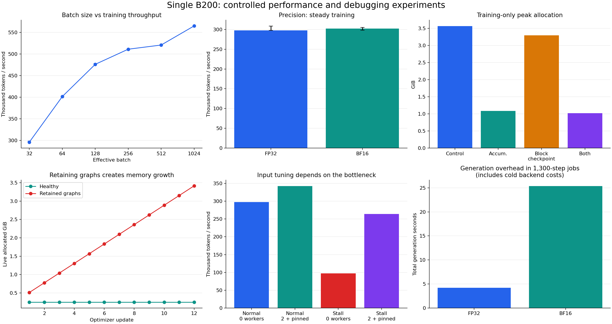

# Single-B200 performance and debugging report

## Outcome

All 14 requested steps have evidence below. The audit verified **75 isolated
experiment results**: 70 normal completions, two expected OOMs, two successful
NaN detections, and the original resume failure before its fix. The four
full-model gradient checks are additional correctness checks, not counted as
separate result directories. GPU 0 was used; all eight GPUs were idle afterward.

The most useful findings are:

- Pinned/nonblocking input transfers improve this small workload without the
  large memory cost of increasing the batch. Extra workers alone did not help.
- BF16 saves about 24% peak allocation but has similar steady training speed
  here. Its apparent whole-job regression is dominated by cold generation in
  the cuDNN attention path, not persistent sixfold-slower generation.
- Accumulation is effective for fitting the workload but slows this already
  small model. Block checkpointing saves less because large vocabulary/loss
  tensors are outside the checkpointed blocks.
- Compilation improves warmed throughput approximately 18%, but startup cost
  matters for a 1,300-update job. Cached and cold runs must be distinguished.
- An actual GPU-resume bug was reproduced, fixed, and verified with bit-exact
  controlled replay.

Ranges in the batch/precision charts are observed min/max across three runs,
not confidence intervals. Memory mitigation and retention plots are individual
controlled demonstrations. The generation panel includes cold backend costs.

## Controls and timing definitions

Hardware/software: NVIDIA B200, driver 580.126.20, PyTorch 2.11.0+cu128, CUDA
runtime 12.8, one CPU intra-op thread per worker. Core suite processes specify
`CUDA_VISIBLE_DEVICES=0`, `OMP_NUM_THREADS=1`, and
`CUBLAS_WORKSPACE_CONFIG=:4096:8`. The model has 12,343,488 learned parameters.
All workers used identical full initial-parameter hashes and unchanged model
and data source. Dataset hashes and the final source inventory are in
[metadata.json](metadata.json); measured source hashes are also in each result.

The primary workload uses seed 42, FP32 eager, effective batch 32, sequence
length 128, AdamW at 3e-4, the original clipping settings, and a cosine schedule
ending at update 1,300. It processes 5,324,800 training token positions. BF16,
accumulation, block checkpointing, and compilation retain that workload unless
their specific probe says otherwise.

This is a new instrumented baseline, not the old DDP timing harness. The lab
releases an unused logits reference promptly and records CUDA events and memory
counters. Gradient equivalence to the original model was checked first.
Ordinary training math was not changed; `train.py` changed only to fix resume.

- Twenty real updates warm up the GPU. Their training counts toward learning,
  but their time/tokens are excluded from steady throughput.
- Training wall time includes input loading, transfers, forward/backward, and
  optimizer updates. Evaluation, generation, and final checkpoint writes are
  timed separately, with synchronization at phase boundaries.
- CUDA-event step time starts after input loading. It includes stream execution
  and intervening host launch gaps, so it is not a pure sum of kernel durations.
- Whole-job time includes initialization and warmup, excluding interpreter/import,
  final parameter hashing, snapshot export, and result serialization. File-write
  timing does not establish fsync-level checkpoint durability.
- Separate profiles capture updates 23–27. Logical CPU step annotations are
  counted once; GPU annotations with the same names are not double-counted.
- Standard performance/loader/batch cases use three unprofiled repeats. Failure
  drills and memory-mitigation demonstrations are individual runs.

## 1–4. Baseline, phase timing, and profile

Median values from the three 1,300-update jobs:

| Measurement | FP32 eager | BF16 autocast |
|---|---:|---:|
| Steady training tokens/sec | 297,733 | 302,008 |
| Timed training wall time, excluding 20 warmup updates | 17.61 s | 17.36 s |
| Evaluation time across the job | 1.68 s | 1.92 s |
| Generation time across the job | 4.20 s | 25.35 s |
| Final checkpoint write | 0.18 s | 0.18 s |
| Whole-job time | 25.91 s | 48.16 s |
| Peak PyTorch allocation | 3.56 GiB | 2.69 GiB |
| Final validation loss | 3.609478 | 3.600538 |

These separately calculated medians do not have to sum to the median whole-job
time; setup and warmup are also included only in that whole-job measurement.
The precision throughput ranges overlap, so the small median BF16 advantage
does not establish a substantial training speedup.

The warmed FP32 profile contains approximately 10.17 ms of GPU kernel events
per captured step, with matrix multiplication, attention, and loss operations.
Its profiled CPU step averages 18.66 ms. Those diagnostic times include
instrumentation overhead and are not the unprofiled throughput benchmark.
Named regions connect the events to load, transfer, forward, backward, and
optimizer phases. See `baseline-profile/trace.json` and `operators.txt` in the
raw output directory.

## 5. Batch-size scaling at matched training tokens

Every run below processes 32,768 sequence examples / 4,194,304 token positions.
The schedule spans the run's full update count. Larger batches therefore make
fewer optimizer updates; learning behavior is not held equivalent by matching
tokens alone.

| Effective batch | Updates | Median tokens/sec | Peak allocation | Final validation loss |
|---:|---:|---:|---:|---:|
| 32 | 1,024 | 295,856 | 3.56 GiB | 3.7671 |
| 64 | 512 | 401,353 | 6.91 GiB | 4.0672 |
| 128 | 256 | 475,983 | 13.63 GiB | 4.8735 |
| 256 | 128 | 510,953 | 27.05 GiB | 6.1377 |
| 512 | 64 | 520,640 | 53.89 GiB | 7.7149 |
| 1,024 | 32 | 564,828 | 107.58 GiB | 8.9530 |

Throughput still increases at the largest successful tested batch, so no flat
throughput plateau was established before the tested memory-failure bracket.
The batch-1,024 run has only 12 timed updates after warmup; three repeats do not
make this a precise maximum-throughput characterization. The large quality
regression also rules out recommending that batch solely from its tokens/sec.
Retuning optimization or locating the exact largest fitting batch was not done.

## 6. Precision and generation cold start

BF16 saves memory while retaining similar loss and training throughput. It
does not halve the total memory footprint because parameters, gradients, and
optimizer state remain FP32 and some operations use FP32 intermediates.

A fresh-process generation check refines the whole-job result: the first
BF16 80-token call takes **18.994 s**, then repeats take about **0.122 s**. A paired
profile attributes **18.592 s** of cold CPU time to cuDNN attention. Excluding
cuDNN selects Flash Attention, reducing the profiled cold call from **19.970 s
to 1.577 s**, with warmed times near **0.12 s** for both choices.

This localizes the cold cost inside the cuDNN attention path, consistent with
setup/planning as generation visits new sequence lengths. The internal planning
steps were not individually instrumented. See the full
[cold-start analysis](rca/06-bf16-generation-cold-start.md). The context-level
backend change was a diagnostic experiment, not a system-wide setting change.

## 7. Budgeted and physical OOM, followed by recovery

The 85%-budget probe fails at batch 2,048 in `nll_loss_backward`, with 116.68 GiB
already allocated and a further 49.08 GiB requested. The unrestricted probe
reaches 165.76 GiB before failing on another 49.08 GiB allocation in
`_log_softmax_backward_data`, with only 11.83 GiB physically free. Reserved-but-
unused memory is approximately 22 MiB in each case, not evidence of a
fragmentation-dominated failure.

The request exactly matches a dense `[2048 × 128, 50257]` FP32 loss-gradient
tensor. Full Python tracebacks, C++ allocation frames, memory summaries, and
allocator snapshots are preserved. The tested success/failure bracket is
1,024–2,048 examples, not an exact maximum.

A fresh process completes effective batch 2,048 with microbatch 32 × 64
accumulation passes at approximately **3.61 GiB** peak. Fresh training/validation
after both OOMs succeeds; no GPU reset was needed. See
[the OOM analysis](rca/01-allocator-oom.md).

## 8–9. Accumulation and activation checkpointing

Full 1,300-update demonstrations retain effective batch 32:

| Configuration | Training tokens/sec | Whole-job peak allocation | Validation loss |
|---|---:|---:|---:|
| FP32 reference, three-run median | 297,733 | 3.56 GiB | 3.609478 |
| Microbatch 8 × 4 | 96,216 | 2.55 GiB | 3.609430 |
| Block activation checkpointing | 197,637 | 3.30 GiB | 3.609478 |
| Both | 54,120 | 2.55 GiB | 3.609430 |

Full-batch validation masks part of the training-memory reduction. Separate
80-update training-only probes, with evaluation disabled, give:

| Configuration | Peak allocated memory |
|---|---:|
| Reference | 3.560 GiB |
| Accumulation | 1.087 GiB |
| Block checkpointing | 3.296 GiB |
| Both | 1.021 GiB |

Accumulation saves roughly 69% of training peak allocation. Checkpointing saves
less here because the dense vocabulary/loss path is outside the recomputed
blocks. Both mechanisms trade execution time for memory; neither is needed to
fit this default tiny model on B200. The initial gradient checks matched ordinary
and checkpointed gradients exactly, and accumulation within 7.75e-7 maximum
absolute difference. These are not promises of universal bit-exact replay.

## 10. Loader tuning and input-stall diagnosis

Unstalled median throughput is **297,691 tokens/sec** with zero workers,
**293,339** with two workers, **342,341** with two workers plus pinned/nonblocking
transfers, and **344,015** with prefetch factor four.

Injecting 30 ms of delay per collated batch drops throughput to **97,121**.
Two workers with pinned/nonblocking transfers recover **264,166**, approximately
2.72x faster. In the profiled window, CPU `train/load_batch` averages **31.08 ms**
for the stall versus **0.10 ms** after the loader change; GPU kernel time stays
around **10.2 ms** per step. This is an input-wait problem, not slower matrix math.
See [the input-stall analysis](rca/03-input-stall.md). Short loader tests do not
establish every production I/O behavior.

## 11. Non-finite values and graph retention

The two NaN drills stop at the injected update 5 before an invalid update.
One catches loss before backward; the other identifies a bad gradient in
`tok_emb.weight` before clipping/update. A healthy 30-update control completes.
Diagnostic finite scans are excluded from ordinary performance cases. See
[non-finite checks](rca/04-nonfinite-values.md).

Retaining graph-bearing losses grows live allocation from roughly **0.512 GiB
to 3.413 GiB** over 12 updates; the healthy control stays near **0.247 GiB**.
After a cleanup-reference correction in the lab itself, removing the retained
graphs returns live allocation to **0.247 GiB**. Accumulation does not require
keeping all those activation graphs. See
[the retained-graph analysis](rca/05-retained-graphs.md).

## 12. Interruption and resume

The original GPU resume path fails because `map_location=device` moves the
CPU RNG state tensor onto CUDA. `train.py:restore_checkpoint` now loads onto
CPU so model/optimizer loaders place their state correctly while RNG tensors
remain valid for restoration.

A controlled 20-update reference versus resume-from-10 check matches parameters,
optimizer, scheduler, RNG, and progress **bit-for-bit**, with zero maximum
parameter difference. This verification uses deterministic algorithms and the
specified CUDA workspace configuration; it does not prove portability across
hardware, nondeterministic modes, prefetched loaders, or DDP. See
[the resume RCA](rca/02-gpu-resume.md).

## 13. Compilation: steady gains versus startup

Inductor with `fullgraph=True` records one captured graph and no graph breaks.
Across one cold and two cached jobs, median warmed throughput is **350,248
tokens/sec**, approximately **18% above** eager FP32. Peak allocation is
approximately **2.81 GiB**. Final validation losses stay within **0.000022** of
eager; final parameter RMS differences are approximately **2.6–2.8e-6**, not zero.

| Compiled job | First-update latency | Whole-job time |
|---|---:|---:|
| Initial cold cache | 9.107 s | 32.313 s |
| Cached repeat 2 | 2.134 s | 25.016 s |
| Cached repeat 3 | 2.127 s | 25.212 s |

First-update latency includes execution as well as lazy compilation; it is not
a separately isolated compiler-only duration. Cold compilation makes this short
job slower overall than the 25.91-second eager median. Cached whole-job savings
are small and within the short eager-run variation, even though steady training
improves. Longer jobs or combining optimizations require a new controlled test.

## 14. Evidence, verification, and practical next choice

[verification.json](verification.json) checks all 73 core cases plus two
historical diagnostic outcomes, workload arithmetic, finite recorded metrics,
matching initialization/model/data source, gradient equivalence, deterministic
resume, and compiled checkpoint differences. [results.json](results.json)
contains aggregates, per-run configurations, metrics, memory series, source
hashes, profile summaries, and the allocator OOM frames. The
[artifact manifest](artifact-manifest.json) fingerprints eight traces, eight
snapshots, and 30 final worker checkpoints. Resume-check checkpoint files are
retained on the node separately.

Code is in [experiments/single_gpu/](../../experiments/single_gpu/README.md).
Raw logs/traces/snapshots are local and on the node under
`runs/single-gpu-b200-2026-11-08/`; checkpoint tensors and the compiler cache
remain on the node. Large raw outputs are ignored by Git. The old
[DDP experiment](../../docs/b200-scaling-results.md) has a different timing
harness and should not be blended directly with these runtimes.

For this exact small workload, the strongest low-memory-pressure candidates
are pinned/nonblocking transfers and sufficiently amortized compilation.
Accumulation is a demonstrated fitting tool, not the default speed choice.
BF16 is useful for memory but needs representative cold/warm generation checks.
No single configuration was promoted as globally optimal: validation quality,
startup cost, memory limits, and steady throughput favor different choices.
